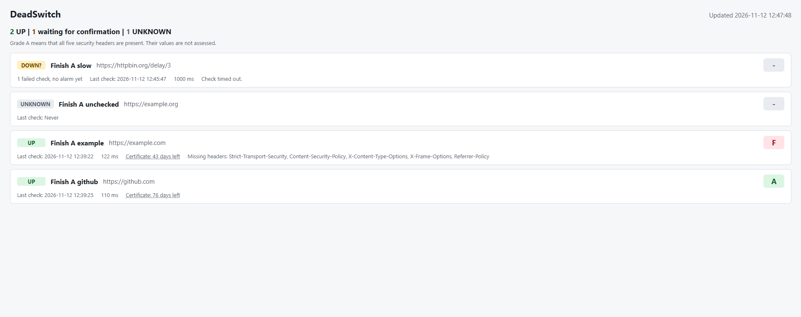

# DeadSwitch

DeadSwitch is a personal uptime monitor. You register web services, and the application checks them on a schedule or on request. It saves every check, shows the result on a small dashboard, and sends a message to Discord when something changes.

This version is made to run on your own computer only. It has no login, on purpose. Read "Threat model" before you change how it listens.



## What it does

- **Health checks.** One `GET` request per check. A service is `UP`, `DOWN` or `UNKNOWN`. A timeout, a failed connection and an HTTP 4xx or 5xx are `DOWN`. `UNKNOWN` means that no request was sent, because the address was blocked.
- **History.** Every check is saved with its time, status code, response time and failure reason.
- **Notifications.** One Discord message when a service goes from UP to DOWN or from DOWN to UP, never one per check. DOWN is only reported after 2 failed checks in a row, so a single timeout gives no message.
- **Security checks,** from the same request as the health check:
  - The five security headers `Strict-Transport-Security`, `Content-Security-Policy`, `X-Content-Type-Options`, `X-Frame-Options` and `Referrer-Policy`, with a grade from A to F. The grade says how many are present, not whether their values are good.
  - The expiry date of the TLS certificate, with a warning when 14 days or fewer are left (configurable), and again at 7 days and at 1 day.
  - Where a redirect points, with a warning when it starts to point to another domain.
- **Dashboard.** One card per service at `/`, updated every 10 seconds. It only reads.

Built with .NET 10, ASP.NET Core, EF Core and SQLite. The code is split into four projects, and dependencies point inward only: `Domain` (rules), `Application` (services and interfaces), `Infrastructure` (database, HTTP probe, Discord) and `Api` (endpoints, background worker, dashboard).

## Run it locally

You need the .NET 10 SDK and the `dotnet-ef` tool.

Create or update the database first. The application does not run migrations by itself, so do this again after you pull a new migration:

```powershell
dotnet ef database update --project DeadSwitch.Infrastructure --startup-project DeadSwitch.Api
```

Start the application:

```powershell
dotnet run --project DeadSwitch.Api --launch-profile http
```

Open `http://localhost:5201` for the dashboard. Stop the application with Ctrl+C.

Register a service and check it once:

```powershell
$body = '{"name":"Example","url":"https://example.com"}'
$service = Invoke-RestMethod -Method Post -Uri http://localhost:5201/services -ContentType 'application/json' -Body $body
Invoke-RestMethod -Method Post -Uri "http://localhost:5201/services/$($service.id)/check"
```

### Settings

| Key | Environment variable | Meaning |
|---|---|---|
| `Discord:WebhookUrl` | `Discord__WebhookUrl` | The address of a Discord webhook. A secret. Empty or missing turns notifications off |
| `SecurityWarnings:CertificateWarningDays` | `SecurityWarnings__CertificateWarningDays` | Warn when this many days or fewer are left of a certificate. Default 14, allowed 1 to 365 |
| `Monitoring:Enabled` | `Monitoring__Enabled` | `false` turns the background worker off. Manual checks still work |
| `ConnectionStrings:DeadSwitchDatabase` | `ConnectionStrings__DeadSwitchDatabase` | The SQLite file. Default `Data Source=deadswitch.db` |

A webhook address or a number of warning days that is not allowed stops the application at startup, with a fixed text.

### Endpoints

| Method and route | Purpose |
|---|---|
| `GET /` | The dashboard |
| `GET /health` | Health of the application itself |
| `POST /services` | Register a service. `name` and `url` are required; `intervalSeconds` (10 to 86400, default 60), `timeoutSeconds` (1 to 60, default 10) and `isEnabled` (default true) are optional |
| `GET /services` | List the services |
| `GET /services/overview` | One row per service with its latest check. The dashboard reads this |
| `GET /services/{id}` | One service |
| `PUT /services/{id}` | Replace a service's configuration. All five fields are required |
| `DELETE /services/{id}` | Delete a service and its history |
| `POST /services/{id}/check` | Check a service now and save the result |
| `GET /services/{id}/history?skip=&take=` | The saved checks, newest first. `take` is 1 to 200 |
| `GET /check?url=` | Check an address once without saving anything |

Every time in the API is UTC and ends with `Z`. Errors use the Problem Details format with fixed texts.

## Run the tests

```powershell
dotnet build DeadSwitch.slnx
dotnet test DeadSwitch.slnx
```

No test reaches a real website or Discord. HTTP in the tests goes to local servers on the loopback address, to stubs, or through a fake name lookup.

## Threat model

### What the API lets a caller do

The whole point of the application is to make this computer send requests to addresses that someone else has typed in. Anyone who can call the API can register addresses, start checks, and read, change and delete every service. There is no login. Everything below exists to limit who can call the API, and what a request from it can reach.

### Locked to your own computer

Being on this computer is the only permission there is. Three layers keep it that way:

| Layer | Stops | Does not stop |
|---|---|---|
| The launch profile listens on `localhost` only | Other computers on the network | Other programs and users on this computer |
| `LocalOnlyCheck` reads the addresses the server really listens on after it has started. If one of them is not a loopback address, the application logs why and stops with exit code 1 | A wrong address by mistake, for example from `--urls` or an environment variable | The port is open for a moment before the application stops. A tunnel or a proxy set up outside the application cannot be seen from inside it |
| `AllowedHosts` only accepts `localhost`, `127.0.0.1` and `[::1]` as host name | DNS rebinding, where a site makes its own name point to this computer | A request that sends `Host: localhost` |

### Requests to internal addresses (SSRF)

A registered address must never make the application call this computer or the network behind it. The protection has two layers, because a host name that looks public can still point to a private address:

1. **When an address is registered or checked,** `UrlSafety` only accepts `http` and `https` on port 80 or 443, without credentials or a fragment. It rejects `localhost` and every private, loopback, link-local and reserved address range, also when the address is written in an unusual form.
2. **When the connection is opened,** `PublicInternetConnector` looks the name up and checks every address it got. One address that is not public is enough to refuse the host. It then connects straight to an address it has checked, which is the protection against a name that changes between the check and the connection.

Redirects are never followed, no proxy is used, and no cookies are kept. A blocked address gives the status `UNKNOWN`. The Discord client uses the same protected handler, so there is no second way out.

What a monitored site sends back is treated as untrusted. Only a status code, the presence of five headers, a certificate date and at most one host name from a redirect are saved. The raw `Location` value is never saved, shown or sent on.

### The dashboard and requests from other sites

- Every answer has `Content-Security-Policy: default-src 'none'; script-src 'self'; style-src 'self'; connect-src 'self'; base-uri 'none'; form-action 'none'; frame-ancestors 'none'`, together with `X-Content-Type-Options: nosniff`, `X-Frame-Options: DENY` and `Referrer-Policy: no-referrer`.
- Names, addresses and failure reasons come from users and servers. The page writes them as plain text only, and an address is never a link. The policy is the second layer: even if text reached the page as HTML, the browser would refuse to run it.
- The page only reads. It has no form and no button.
- A page on another site, open in your browser, is also "on this computer". `CrossSiteRequests` therefore answers 403 to every API request that a browser marks as coming from another site, by reading `Sec-Fetch-Site` and `Origin`. This protects against browsers only: another program on the computer sends neither header.

### The webhook address

The token in a Discord webhook address is all anyone needs to post in the channel, so the address is a secret.

- It is read from user secrets or from the environment variable, never from a file in the repository.
- It is checked at startup. Only `https://discord.com/api/webhooks/{id}/{token}` and the same path on `discordapp.com` are accepted, and a wrong address stops the application with a fixed text that does not show it.
- It is never logged. The automatic request logging is turned off for the Discord client, and a failed send is logged with a fixed text or with the type of the exception only.
- A message holds the service's name, fixed texts, the time of the check and, for a redirect warning, one host name. The address of the service is not sent. Names are written as inline code and every mention is turned off, so a name cannot ping anyone or become a link.

User secrets are a plain file in your user profile. They keep the address out of git, not away from someone who can read your profile. If the address leaks, delete the webhook in Discord and create a new one.

### What is not protected

- **There is no login and no rate limiting.** This is a deliberate choice for this version. Every program and every user on the same computer has full access to the API.
- Because of that, the application must not be put on a network or behind a reverse proxy as it is.

## Continuous integration

The workflow in `.github/workflows/build-and-test.yml` runs restore, build and test on every push to `main`, and when it is started by hand. Tests that read the file keep these properties in place:

- **Least privilege.** `permissions` is `contents: read` and nothing else. No secret is used.
- **Pinned actions.** Every action is pinned to a full commit SHA with the version in a comment. A tag can be moved to other code; a commit cannot.
- The checkout does not keep its token for later steps (`persist-credentials: false`).
- A fixed runner version and a timeout.

**Repository settings.** These are settings on GitHub and not files, so the code can only show the workflow file. They were checked by hand on 2026-11-12:

- Actions are allowed from this repository, plus `actions/checkout@*` and `actions/setup-dotnet@*`. Actions created by GitHub in general and Marketplace actions are not allowed.
- Actions must be pinned to a full-length commit SHA.
- Workflow permissions are read-only, and workflows may not create or approve pull requests.

**Cooldown.** A cooldown is a waiting time between the day a new version of an action or a package is published and the day a project starts to use it. A version that turns out to be compromised is usually found and removed within days, so waiting keeps a project out of the first and most dangerous period. Here the versions are pinned and changed by hand, and there is no automatic update tool in the repository, so a cooldown is a habit to keep when a pin is changed, not something a tool enforces.

## Known limitations

- An HTTP 3xx counts as `UP` and the redirect is not followed. The target is never visited, so a redirect to a broken page still counts as up. Monitor the final address.
- The lock that stops two checks of the same service at once works inside one process only.
- The background worker checks one service at a time, so a slow service delays the others.
- The history is never cleaned up.
- A notification that fails is not sent again.
- A grade only says which headers are present. A service that answers with a redirect or over `http` gets no grade.
- Only the first step of a redirect is seen, and redirects made by a page's script are not detected.
- Docker is not set up yet.
